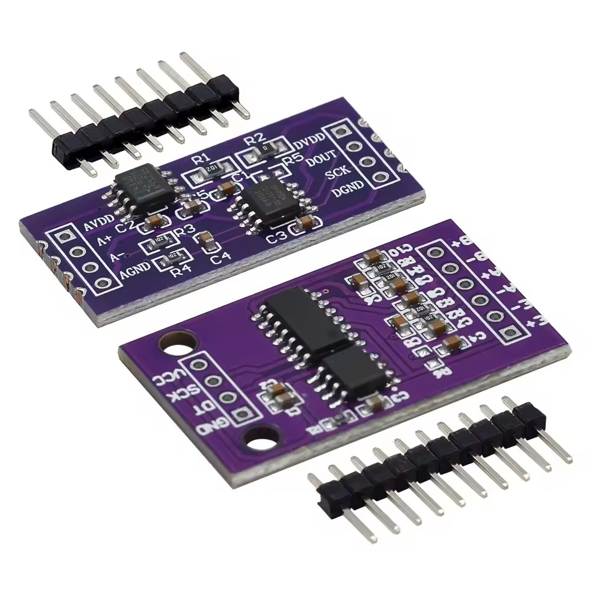

# CS123x - Dual-Framework Driver for Chipsea CS1237 & CS1238 24-bit Differential ADCs

Arduino library and ESP-IDF component for Chipsea [CS1237](https://en.chipsea.com/product/details/?id=1155&pid=77) and [CS1238](https://en.chipsea.com/product/details/?id=1156&pid=77) 24-bit differential ADCs. Designed for weight scales, load cells, and bridge sensors with full PGA control, flexible sampling rates, two-point scale calibration, internal temperature monitoring, and internal short-circuit offset diagnostics.

Built on a single framework-agnostic C++ core with a **camelCase** facade for Arduino and a native **snake_case** API for ESP-IDF (v5.x–6.x) projects — same logic, same protocol implementation, zero duplication between the two. See: [Dual-Framework Library Guide](https://github.com/FMazz97/dual-framework-library-guide) to know how to implement an Arduino and ESP-IDF codebase.

<!-- markdownlint-disable MD033 -->
<p align="center">
  <br>
  <sub>Purple breakout modules for CS1237 (left) and CS1238 (right).</sub>
</p>
<!-- markdownlint-enable MD033 -->

---

## Why This Library?

This library was born out of the need for a high-refresh-rate ADC for dynamic analysis and in-motion measurements, where the most common converters don't offer enough speed.

CS123x aims to fill that gap, providing a modern alternative to popular but slow converters like the HX711, with more flexibility, advanced diagnostics, and sampling rates up to 1280 SPS.

At the time of writing, the documentation available online for the CS1237/CS1238 chips was fragmentary or incomplete, and no reliable Arduino driver existed for them.

### Key Advantages of the CS123x

- **Precision Scale Readings:** Up to 20.7 effective bits (ENOB) for detecting small weight changes.
- **High-Speed Dynamic Weighing:** Sampling rates up to 1280 SPS enable accurate in-motion weighing (conveyor checkweighers), rapid force tracking, and responsive closed-loop control (PID loops).
- **Integrated Temperature Monitoring:** On-chip temperature sensor enables real-time software thermal drift compensation.
- **Advanced Diagnostics:** Built-in internal short mode allows precise zero-point offset calibration without disconnecting the sensor.
- **Full Software Control:** PGA gain (1x, 2x, 64x, 128x) and channel selection are fully programmable on-the-fly via software registers.

> [!TIP]
> **Looking for the full feature list?** See [Key Features](https://github.com/FMazz97/CS123x/blob/main/docs/usage-compatibility.md#key-features) for the complete overview: dual chip support, runtime configuration, dual-channel reads, blocking vs. non-blocking modes, watchdog-safe polling, temperature sensing, short-circuit diagnostics and the weighing engine.

### CS123x vs HX711 Comparison

Both chips are 24-bit Sigma-Delta (Σ-Δ) ADCs designed for strain gauge sensors, but they target different application requirements:

| Feature | HX711 | CS123x Family (CS1237 / CS1238) |
| :--- | :--- | :--- |
| **Max Sampling Rate** | 10 or 80 SPS | **Up to 1280 SPS** (10, 40, 640, 1280 Hz) |
| **Effective Resolution (ENOB)** | ~18.5 Bits (at 10 Hz, Gain 128) | **Up to 20.7 Bits** (at 10 Hz, Gain 128) |
| **Temperature Diagnostics** | None | **Integrated On-Chip Temp Sensor** |
| **Offset Calibration Mode** | External zeroing | **Internal Short-Circuit Mode** |
| **Target Application** | Static weighing & low-cost scales | Dynamic checkweighing, fast process control, thermal compensation |

> [!NOTE]
> **Architecture & Application Scope:**
> Like most high-resolution scale ICs, the CS123x uses a **Sigma-Delta (Σ-Δ)** architecture with a digital filter (Sinc3). This makes it ideal for strain gauge load cells in dynamic weighing, material testing, and industrial process automation.
> For sub-millisecond impact or ballistic testing, dedicated **SAR ADCs** paired with **piezoelectric load cells** are typically required, even though this comes at a significantly higher system cost and complexity. The CS123x delivers high-speed capability for low-cost strain gauge sensors at an accessible price point.

---

## Quick Install

Tested on AVR (ATmega328P, ATmega2560), ESP32 / ESP32-S3 / ESP32-C3 (Arduino & ESP-IDF) and ESP8266. See the [full list of tested boards](https://github.com/FMazz97/CS123x/blob/main/docs/usage-compatibility.md#tested-microcontrollers).

### Arduino IDE

[](https://www.ardu-badge.com/CS123x)

Open the **Library Manager** (`Ctrl+Shift+I`), search for `CS123x`, and click **Install**.

### ESP-IDF

[](https://components.espressif.com/components/fmazz97/cs123x)

In your project directory, run:

```bash
idf.py add-dependency "fmazz97/cs123x^2.0.0"
```

### PlatformIO

[](https://registry.platformio.org/libraries/fmazz97/cs123x)

Add it to your `platformio.ini` (works with both `framework = arduino` and `framework = espidf`):

```ini
lib_deps = fmazz97/cs123x@^2.0.0
```

> [!TIP]
> Manual installation, local development (`override_path`) and native ESP-IDF inside PlatformIO are covered in the [**Installation Guide**](https://github.com/FMazz97/CS123x/blob/main/docs/installation.md).

---

## Wiring & Pinout

The CS123x uses a custom 2-wire serial protocol over standard digital GPIO pins.

**MCU to ADC module (digital):**

| Pin Symbol (PCB) | Description | MCU Connection |
| :--- | :--- | :--- |
| **VCC / DVDD** | Digital Power Supply (2.7V – 5.5V) | MCU 3.3V or 5V |
| **GND / DGND** | Digital Ground | MCU GND |
| **SCK / SCLK** | Serial Clock Input / Power-Down Control | Any Digital Output Pin |
| **DT / DOUT** | Bidirectional Data Line / Ready Signal | Any Digital GPIO Pin |

**Module to sensor (analog):**

| Pin Symbol (PCB) | Description | Sensor (Eg. Load Cell) |
| :--- | :--- | :--- |
| **E+ / AVDD** | Bridge Excitation Voltage (+) | Red Wire (*E+*) |
| **E- / AGND** | Analog Ground (-) | Black Wire (*E-*) — Cable shield |
| **A+** | Channel A Non-Inverting Signal | Green Wire (*S+*) |
| **A-** | Channel A Inverting Signal | White Wire (*S-*) |
| **B+ / B-** | Channel B Differential Signal *(CS1238 only)* | Second Sensor Signal |

> [!WARNING]
> **Low-impedance sensors (e.g. 350 Ω load cells):** on the reference breakout modules, the onboard TL431 voltage reference is current-limited by resistor **R1 (1 kΩ)**. With low/medium-impedance bridges the reference voltage collapses below the chip's minimum threshold, causing saturated, noisy, or stuck readings. A simple resistor mod fixes it: see [Current Limit for Low-Impedance Sensors](https://github.com/FMazz97/CS123x/blob/main/docs/hardware.md#current-limit-for-low-impedance-sensors) for the calculation and the recommended values. Voltage reference modes and the module's architecture are described in [Hardware Architecture](https://github.com/FMazz97/CS123x/blob/main/docs/hardware.md).

---

## Quick Example

The typical scale workflow is: `begin()` → `tare()` → `calibrateScale()` → `readNetUnits()`.

```cpp
CS123x adc(CS123X_TYPE_CS1237, DOUT_PIN, SCLK_PIN);

// in setup():
adc.begin();
adc.tare(CALIBRATION_SAMPLES);
adc.calibrateScale(KNOWN_WEIGHT, CALIBRATION_SAMPLES);

// In loop():
float weight = adc.readNetUnits(SAMPLES);
```

<!-- markdownlint-disable MD033 -->
<details>
<summary><strong>ESP-IDF version</strong></summary>

```cpp
static cs123x adc(CS123X_TYPE_CS1237, DOUT_PIN, SCLK_PIN);

// In app_main():
adc.begin();
adc.tare(CALIBRATION_SAMPLES);
adc.calibrate_scale(KNOWN_WEIGHT, CALIBRATION_SAMPLES);

// In the measurement loop:
float weight = adc.read_net_units(SAMPLES);
```

</details>
<!-- markdownlint-enable MD033 -->

Full sketches and projects, including serial diagnostics and error handling, are in the [`examples/`](https://github.com/FMazz97/CS123x/tree/main/examples) directory. Step-by-step explanation in the [Usage Guide](https://github.com/FMazz97/CS123x/blob/main/docs/usage-compatibility.md#usage-examples).

---

## Documentation

| Document | Contents |
| :--- | :--- |
| [**Installation Guide**](https://github.com/FMazz97/CS123x/blob/main/docs/installation.md) | Arduino IDE, ESP Component Registry, PlatformIO, manual and local-development setups |
| [**Usage & Compatibility**](https://github.com/FMazz97/CS123x/blob/main/docs/usage-compatibility.md) | Full feature list, framework HAL, tested microcontrollers, usage examples |
| [**Hardware Architecture**](https://github.com/FMazz97/CS123x/blob/main/docs/hardware.md) | Voltage reference modes, TL431 current limit and the resistor fix |
| [**API Reference**](https://github.com/FMazz97/CS123x/blob/main/src/core/cs123x.h) | Doxygen-documented [`cs123x.h`](https://github.com/FMazz97/CS123x/blob/main/src/core/cs123x.h) and [`cs123x_types.h`](https://github.com/FMazz97/CS123x/blob/main/src/core/cs123x_types.h) |

---

## Credits & Acknowledgments

- **Hardware Design & Reference Schematics:** Special thanks to [yasir-shahzad](https://github.com/yasir-shahzad) for providing open-source hardware documentation, schematics, and module images (licensed under [GNU GPL v3](https://www.gnu.org/licenses/gpl-3.0.html)):
  - [CS1237 24-Bit ADC Module Repository](https://github.com/yasir-shahzad/CS1237-24-Bit-ADC-Module)
  - [CS1238 24-Bit ADC Module Repository](https://github.com/yasir-shahzad/CS1238-24-Bit-ADC-Module)

---

## License

This project is licensed under the MIT License - see the [LICENSE](https://github.com/FMazz97/CS123x/blob/main/LICENSE) file for details.
