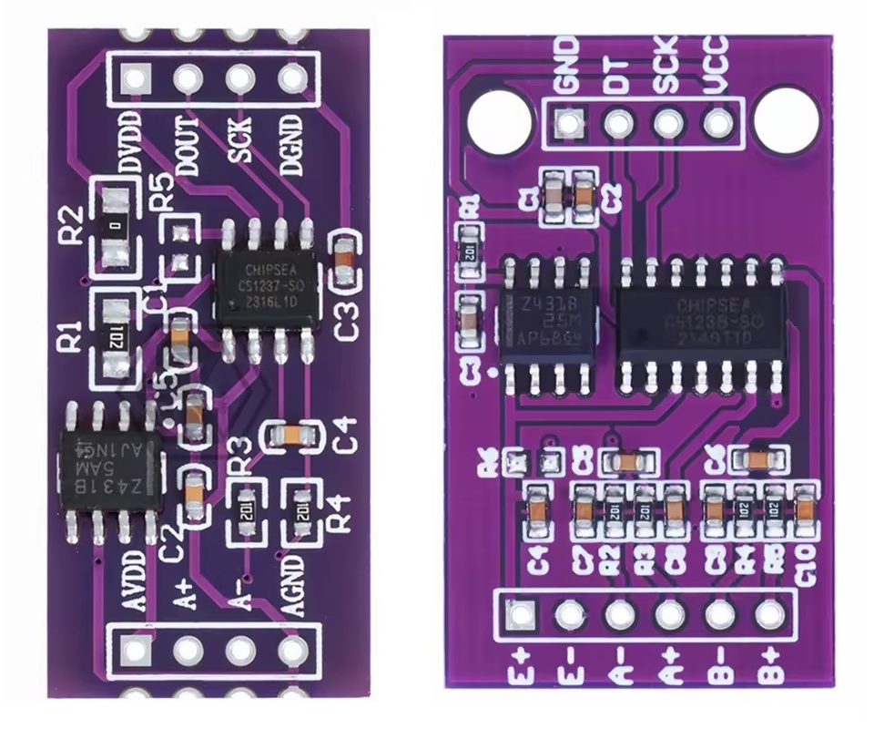

# Hardware Architecture & Voltage Reference

[← Back to README](https://github.com/FMazz97/CS123x/blob/main/README.md)

These breakout modules feature an onboard **TL431 precision shunt reference (2.5V)** to supply a low-noise analog voltage to the bridge excitation, effectively isolating sensitive weight measurements from digital MCU power supply noise.

## Voltage Reference Modes

The library defaults to the **External Reference** mode to match the out-of-the-box hardware configuration of the reference modules shown below.

- **External Reference (`CS123X_INT_REF_OFF`):**
  - The reference modules ship with the jumper pads (**R5** on CS1237 / **R6** on CS1238) **OPEN**. In this state, the module uses the onboard **TL431** to supply a clean **2.5V reference**.
  - Leaving the internal reference **OFF** avoids introducing unwanted noise, ripple, and measurement instability caused by two reference sources interacting on the `AVDD/E+` line.

- **Internal Reference (`CS123X_INT_REF_ON`):**
  - Enables the **internal reference generator** inside the **CS123x** chip, which drives `REFOUT` to output `DVDD/VCC` directly.
  - **Not recommended on stock hardware:** Closing the **R5/R6** solder pads ties `REFOUT` directly to the same `AVDD/E+` node already driven by the onboard **TL431**. Without removing it, the two sources would actively contend on that node instead of one cleanly replacing the other. On the reference modules, the **TL431** shares a trace with `AVDD/E+` that can't be isolated without PCB rework, so in practice this bridge should be left open.

<!-- markdownlint-disable MD033 -->

   
  <strong>Reference Hardware Target:</strong> Purple breakout modules for CS1237 (left) and CS1238 (right) featuring an onboard TL431 precision voltage reference IC.

---

## Current Limit for Low-Impedance Sensors

> [!WARNING]
> The onboard TL431 voltage reference is current-limited by resistor **R1 (1 kΩ)**. While sufficient for high-impedance sensors (≥ 1.7kΩ), it cannot supply enough current for low/medium-impedance transducers such as standard **350 Ω full-bridge load cells**.

### Issue Summary

Any sensor connected to the `AVDD/E+` rail draws excitation current through **R1**. The reference node stays in regulation only as long as the current it can supply covers what the sensor and the **TL431** itself both need:

  <i>Iavail ≥ Itotal</i>

**Current required by the sensor and the TL431's own bias:**

  <i>Itotal = Isensor + Ibias(TL431) = VREF / Rsensor + ~1 mA</i>

**Current actually available from DVDD/VCC through R1:**

  <i>Iavail = (VDVDD/VCC - VREF) / R1</i>

#### Example: Standard 350 Ω Load Cell

- **Sensor Demand:** 2.5 V / 350 Ω ≈ **7.1 mA**
- **Total Budget Needed:** 7.1 mA + 1.0 mA ≈ **8.1 mA**

However, the stock resistor **R1 = 1 kΩ** severely restricts the available current supplied from `DVDD/VCC`:

- **At 3.3 V:** Iavail = (3.3 V - 2.5 V) / 1 kΩ = **0.8 mA** *(not enough)*
- **At 5.0 V:** Iavail = (5.0 V - 2.5 V) / 1 kΩ = **2.5 mA** *(not enough)*
<!-- markdownlint-enable MD033 -->

**Symptom:** The reference voltage collapses well below 2.5 V when a low-impedance load is connected, dropping below the CS123x minimum reference threshold (1.5 V) and causing saturated, noisy, or stuck ADC readings.

### Fix

Lower the effective series resistance by adding a resistor between the `DVDD/VCC` and `AVDD/E+` nodes or soldering a resistor directly in parallel with **R1** according to the formula above.

For standard **350 Ω load cells**, example values at the nominal supply voltage:

| DVDD/VCC Voltage | Parallel Resistor | Equivalent R1 | Available Current |
| :--- | :--- | :--- | :--- |
| **3.3V** | **100 Ω** | ~91 Ω | ~8.8mA |
| **5.0V** | **330 Ω** | ~248 Ω | ~10.1mA |

> [!IMPORTANT]
> Size the parallel resistor so the available current stays close to what the connected sensor needs plus the TL431's own bias, using the formulas above with your lowest supply voltage and sensor resistance. Excess current only adds TL431 noise and dissipation, while too little loses regulation (e.g. the 100 Ω above does so below ~3.24V with a 350 Ω sensor). For CS1238, count the draw of both channels.
>
> Measurement stability (noise, drift) depends on the module's analog hardware and wiring, and is outside the scope of this library.
